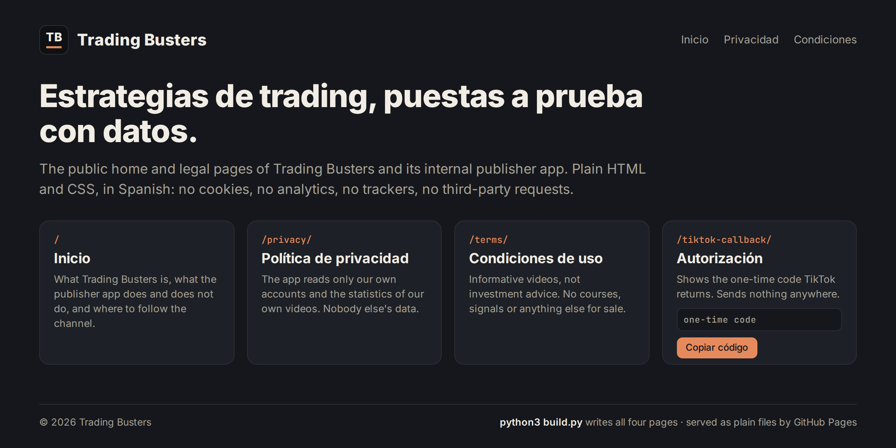
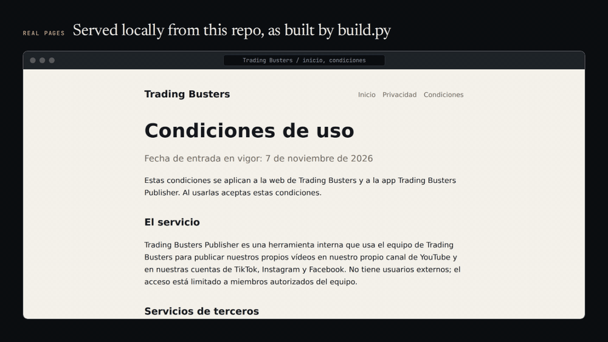
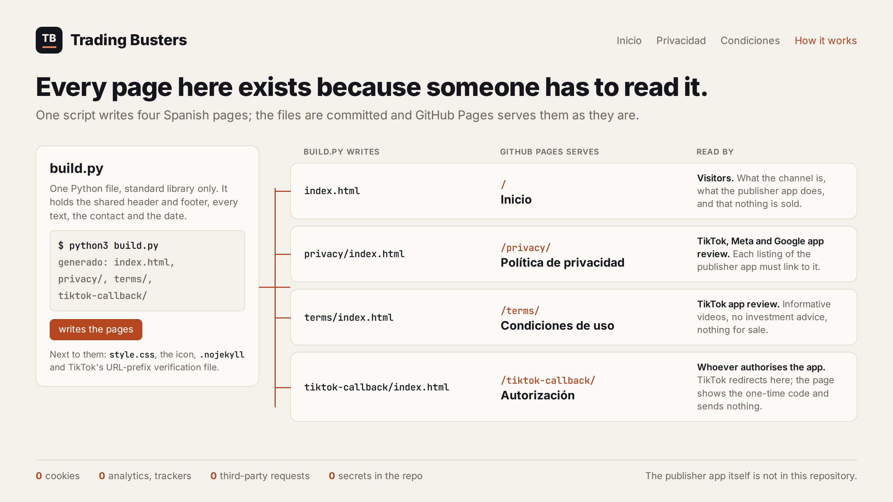

<p align="center"><a href="#demo"><picture>
  <source media="(prefers-color-scheme: light)" srcset="docs/images/banner-light.png">
  
</picture></a></p>

<p align="center"><b>Trading strategies, put to the test with data. Home and legal pages, in Spanish.</b><br>
<a href="#how-to-build">Install</a> · <a href="#demo">Demo</a> · <a href="#how-it-works">How it works</a> · <a href="build.py">Source</a></p>

<p align="center">
  
  
  
  
</p>

# Trading Busters: web legal

Inicio, política de privacidad y condiciones de uso de Trading Busters y de su app interna de publicación (Trading Busters Publisher). TikTok, Meta y Google apuntan sus fichas de app a estas páginas. HTML/CSS plano: sin cookies, sin analítica, sin rastreadores y sin peticiones a terceros.

- Edita `build.py` (cabecera y pie comunes, textos, email de contacto) y ejecuta `python3 build.py`.
- `assets/app-icon-1024.png` es el icono de 1024x1024 de la app (TikTok); es provisional hasta que haya logo de la marca.
- `tiktok-callback/` solo muestra el código de un solo uso que devuelve TikTok; no envía nada a ningún sitio.
- En este repo nunca va ningún secreto.
- La web de estrategias es otra cosa (interna, lagowski/trading-studio#16).

## How to build

```bash
python3 build.py                  # writes index.html, privacy/, terms/, tiktok-callback/
python3 -m http.server 8000       # preview at http://localhost:8000
```

## Demo

<p align="center"></p>

<sub>Real pages, served locally from this repo: the home page and the terms page.</sub>

## How it works

<p align="center"></p>

`build.py` writes the four pages (in Spanish) with one shared header and footer. GitHub Pages serves them as plain
files, and the TikTok, Meta and Google app listings of Trading Busters Publisher link to the privacy and terms pages.
Nothing on the pages calls a third party.
